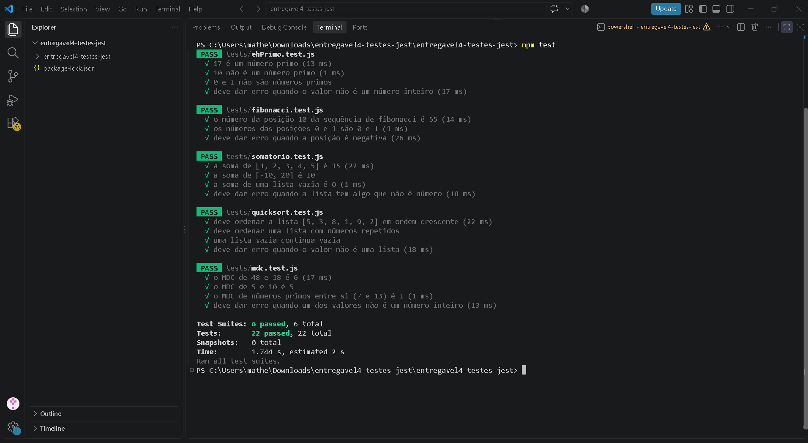

# Entregável #4 — Testes unitários com Jest

**Disciplina:** Desenvolvimento de Software em Nuvem e Ambientes de Desenvolvimento de Software (GR-R-262-N389-90)
**Aluno:** Matheus Lucas Oliveira — Análise e Desenvolvimento de Sistemas, UNIFOR

Este repositório usa os algoritmos fundamentais da atividade #1 (em JavaScript), agora revisados com programação defensiva e com testes unitários escritos com a biblioteca [Jest](https://jestjs.io/).

## Como executar os testes

Pré-requisito: ter o [Node.js](https://nodejs.org/) instalado.

```bash
npm install
npm test
```

- `npm install` baixa o Jest (fica na pasta `node_modules`).
- `npm test` roda todos os arquivos da pasta `tests`.

## Resultado esperado

```
PASS tests/quicksort.test.js
PASS tests/somatorio.test.js
PASS tests/ehPrimo.test.js
PASS tests/mdc.test.js
PASS tests/fibonacci.test.js
PASS tests/contagem.test.js

Test Suites: 6 passed, 6 total
Tests:       22 passed, 22 total
```

## Evidências

### Resultado do `npm test`


## Estrutura do projeto

```
funcoes/            -> os algoritmos
  contagem.js
  ehPrimo.js
  fibonacci.js
  mdc.js
  quicksort.js
  somatorio.js
tests/              -> os testes de cada algoritmo
  contagem.test.js
  ehPrimo.test.js
  fibonacci.test.js
  mdc.test.js
  quicksort.test.js
  somatorio.test.js
package.json        -> configura o comando "npm test"
```

## Algoritmos e testes

| Algoritmo | O que faz | Testes |
|-----------|-----------|--------|
| `contagem(primeiro, ultimo)` | Conta os inteiros entre dois números | 3 |
| `ehPrimo(numero)` | Diz se o número é primo | 4 |
| `fibonacci(posicao)` | Retorna o número da sequência na posição | 3 |
| `mdc(a, b)` | Máximo divisor comum (Euclides) | 4 |
| `quicksort(lista)` | Ordena a lista em ordem crescente | 4 |
| `somatorio(numeros)` | Soma os números da lista | 4 |

## O que foi revisado no código (clean code e programação defensiva)

- **Nomes significativos:** variáveis como `n`, `arr` e `x` viraram `posicao`, `lista`, `numero`, `divisor`, `quantidade`.
- **Validação da entrada:** cada função confere se recebeu o tipo certo (número inteiro ou lista de números) antes de calcular.
- **Tratamento de exceções:** entrada inválida gera um erro claro (`TypeError` ou `RangeError`) em vez de devolver um resultado errado. Há testes cobrindo esses erros.
- **Funções exportadas com `module.exports`:** assim os testes conseguem importar cada função com `require`.
- **Sem efeitos colaterais:** o `quicksort` não altera a lista original, e os `console.log` de exemplo foram removidos das funções.
